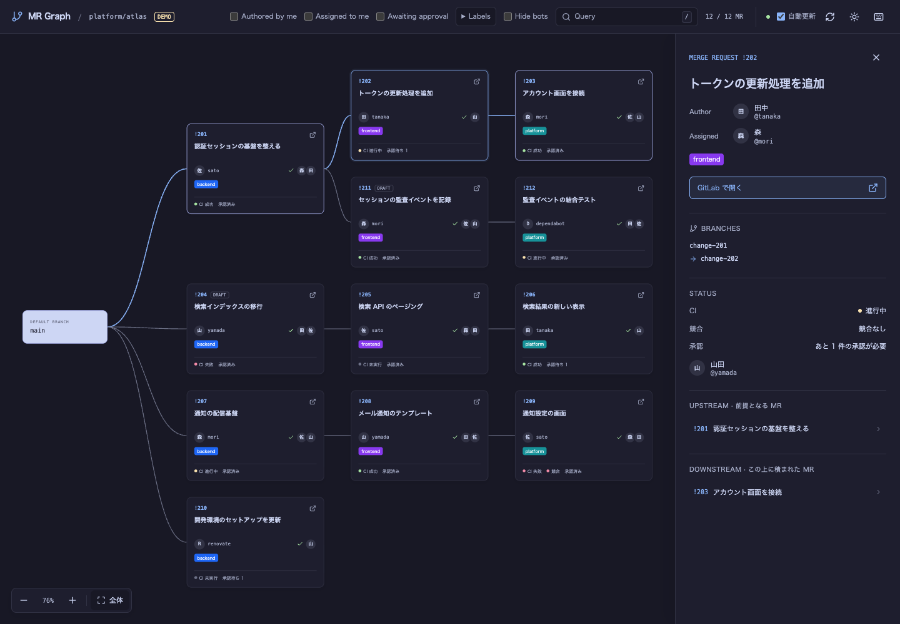

# gitlab-mr-graph

<a aria-label="CI" href="https://github.com/tapioca24/gitlab-mr-graph/actions/workflows/ci.yml">
  
</a>
<a aria-label="license" href="https://github.com/tapioca24/gitlab-mr-graph/blob/main/LICENSE">
  
</a>

A CLI that visualizes branch dependencies between GitLab merge requests. It uses GitLab CLI (`glab`) authentication and displays the graph in your local browser.

It shows all open MRs in the target repository and highlights the upstream and downstream dependencies of the selected MR.



## Installation

```sh
go install github.com/tapioca24/gitlab-mr-graph/cmd/gitlab-mr-graph@latest
```

## Usage

Install and authenticate the [GitLab CLI](https://docs.gitlab.com/cli/) first.

Run the command inside a GitLab repository.

```sh
gitlab-mr-graph
```

Your browser opens automatically. Press Ctrl-C to stop.

```sh
# Do not open the browser automatically
gitlab-mr-graph --no-open
# Specify a port
gitlab-mr-graph --port 8080
# Specify a repository from another directory
gitlab-mr-graph --repo group/project --hostname gitlab.example.com
gitlab-mr-graph --repo https://gitlab.example.com/group/project
```

MR data refreshes every 60 seconds. Automatic fetching pauses while the tab is hidden.

Awaiting approval includes MRs with unmet approval rules. If the approval rules API returns 404 (for example, on a Free self-hosted instance), it includes MRs with a known approval count of zero instead.

### Run as a glab subcommand

Optionally, register a shell alias to run as `glab mr-graph`:

```sh
glab alias set --shell mr-graph 'gitlab-mr-graph "$@"'
glab mr-graph
glab mr-graph --no-open --port 8080
```

`gitlab-mr-graph` must be on your PATH.

### Demo

Try it with sample data, without authentication.

```sh
gitlab-mr-graph --demo
```

To display 100 MRs:

```sh
gitlab-mr-graph --demo --demo-count 100
```

## Keyboard shortcuts

| Key                   | Action                                                              | Conditions                                                                                                      |
| --------------------- | ------------------------------------------------------------------- | --------------------------------------------------------------------------------------------------------------- |
| `/`                   | Focus Query                                                         |                                                                                                                 |
| `A`                   | Toggle Authored by me                                               |                                                                                                                 |
| `S`                   | Toggle Assigned to me                                               |                                                                                                                 |
| `W`                   | Toggle Awaiting approval                                            |                                                                                                                 |
| `G`                   | Open or close Labels; focus the first label when opening             |                                                                                                                 |
| `J` / `↓`             | Focus the next label; stop at the last label                         | Focus is in the open Labels panel.                                                                              |
| `K` / `↑`             | Focus the previous label; stop at the first label                    | Focus is in the open Labels panel.                                                                              |
| `Tab` / `Space`       | Move between controls / toggle a label                               | Focus is in the Labels panel.                                                                                   |
| `B`                   | Toggle Show bots                                                    |                                                                                                                 |
| `U`                   | Toggle automatic refresh                                            |                                                                                                                 |
| `R`                   | Refresh                                                             |                                                                                                                 |
| `T`                   | Toggle theme                                                        |                                                                                                                 |
| `F` / `0`             | Fit the entire graph                                                |                                                                                                                 |
| `+` / `=`             | Zoom in                                                             |                                                                                                                 |
| `-`                   | Zoom out                                                            |                                                                                                                 |
| `H` / `←`             | Move to a direct upstream MR                                        | An MR is selected. Choose the visible candidate closest in vertical position; stay put if none exists.           |
| `L` / `→`             | Move to a direct downstream MR                                      | An MR is selected. Choose the visible candidate closest in vertical position; stay put if none exists.           |
| `K` / `↑`             | Move to the MR above that shares the same direct upstream dependency | An MR is selected and focus is outside Labels. Only visible MRs are considered; stay put if none exists.                                      |
| `J` / `↓`             | Move to the MR below that shares the same direct upstream dependency | An MR is selected and focus is outside Labels. Only visible MRs are considered; stay put if none exists.                                      |
| `↑` / `↓` / `←` / `→` | Pan the graph                                                       | No MR is selected and the graph has focus.                                                                       |
| `Esc`                 | Close details, help or Labels, or return focus from text input to the graph  |                                                                                                                 |
| `?`                   | Show all shortcuts (also available via the header's keyboard button) |                                                                                                                 |

## Development

See [CONTRIBUTING.md](CONTRIBUTING.md) for build, test, and release instructions.

## Acknowledgments

- [gh-pr-graph](https://github.com/orangain/gh-pr-graph)
- [Catppuccin](https://github.com/catppuccin/catppuccin)
- [Lucide](https://lucide.dev/): SVGs from version 0.468.0 and their license are bundled locally
